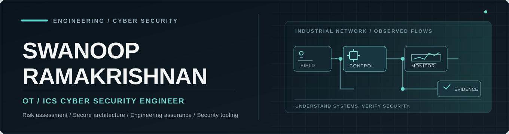

  

  <a href="https://swanoop.github.io/">Portfolio</a> &nbsp;·&nbsp;
  <a href="https://www.linkedin.com/in/swanoop-r/">LinkedIn</a> &nbsp;·&nbsp;
  <a href="https://medium.com/@rswanoop">Writing</a> &nbsp;·&nbsp;
  <a href="https://github.com/swanoop?tab=repositories">All repositories</a>

## About

I'm a cybersecurity engineer working at the intersection of **operational technology, system architecture and security assurance**. My professional work includes OT cyber risk assessments, security requirements, architecture reviews and technical assurance, particularly in rail and other operational-system contexts.

I am interested in the detail behind an assessment: what a system actually does, how its components communicate, which changes matter, and how to demonstrate that a security measure works. I build tools and small test environments to investigate those questions with observable evidence.

## Selected projects

### 01 / [OTScope](https://github.com/swanoop/OTScope)

**Passive industrial traffic analysis and behavioural comparison.** Parses PCAP/PCAPNG captures, reconstructs observed assets and communications, examines Modbus/TCP, IEC 60870-5-104 and S7comm activity, and compares traffic against baselines and defined communication policies. Findings remain traceable to packet evidence.

`Python` · `PCAP / PCAPNG` · `Modbus/TCP` · `IEC 104` · `S7comm`

### 02 / [OT Network Studio](https://github.com/swanoop/ot-network-studio)

**A local-first workspace for OT architecture sketches.** Design networks with industrial components, zones, asset metadata and protocol tags. Includes reusable templates and JSON/PNG exports. It is a design tool, not a network scanner.

`TypeScript / JavaScript` · `Network architecture` · `IEC 62443-style zones` · `Asset inventory`

### 03 / [RailCAN](https://github.com/swanoop/RailCAN)

**Synthetic CAN telemetry for repeatable testing.** Simulates linked train signals, journey scenarios and faults with a local dashboard, capture exports, replay and optional SocketCAN output. Uses a deliberately synthetic message layout, not an OEM protocol.

`Python` · `Classical CAN` · `Telemetry` · `Fault injection` · `SocketCAN`

### 04 / [ForteCRA](https://github.com/swanoop/ForteCRA)

**A browser-based EU Cyber Resilience Act self-assessment workspace.** Explore requirement coverage, product-security maturity, evidence references, reporting timelines and exportable assessments. A demonstration tool, not a certification or legal-conformity determination.

`JavaScript` · `Product security` · `EU CRA` · `Local-first`

Earlier project: <a href="https://github.com/swanoop/ssl-stripping-detector">SSL Stripping Detection Tool</a>, an educational PCAP analysis prototype from 2023 that is no longer actively maintained.

## Engineering focus

- **Understand the operational system:** system boundaries, essential functions, assets, interfaces and dependencies.
- **Turn risk into engineering decisions:** threat scenarios, security requirements, segmentation, zones and conduits, and proportionate controls.
- **Build and examine evidence:** passive traffic analysis, reproducible lab testing, technical reviews, security testing and residual-risk documentation.

**Standards and frameworks:** IEC 62443 · CLC/TS 50701 · NCSC CAF · UK NIS Regulations · ISO/IEC 27001 · NIST SP 800-61

## Community and background

- ISA UK Section Board Member; previously served as Cybersecurity Chair.
- Member, NCSC ICS Community of Interest Security Testing Expert Group.
- ISA/IEC 62443 Cybersecurity Fundamentals and Risk Assessment Specialist credentials.
- Member of BCS and the Institution of Engineering and Technology.
- MSc Cybersecurity and Forensics, University of Westminster.

---

Personal projects are independent learning and engineering work. They are not representations of employer or client systems.
