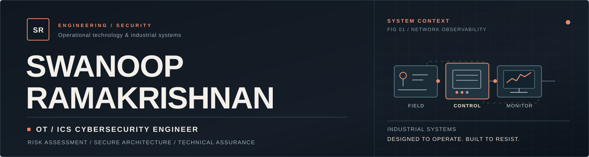
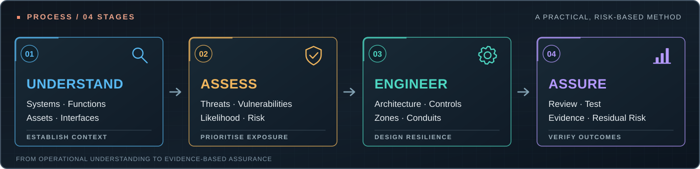

  

  <strong>Operational technology · Industrial control systems · Cybersecurity engineering</strong>

  <a href="https://www.linkedin.com/in/swanoop-r/">LinkedIn</a> &nbsp;·&nbsp;
  <a href="https://swanoop.github.io/">Website</a> &nbsp;·&nbsp;
  <a href="https://medium.com/@rswanoop">Writing</a>

  I work on securing operational systems, from understanding their architecture and assessing cyber risk to translating security requirements into practical engineering controls.

  IEC 62443 · CLC/TS 50701 · OT risk &amp; assurance · Secure architecture · Security testing

## Engineering approach

  <picture>
    <source media="(max-width: 720px)" srcset="./assets/engineering-approach-mobile.svg" />
    
  </picture>

